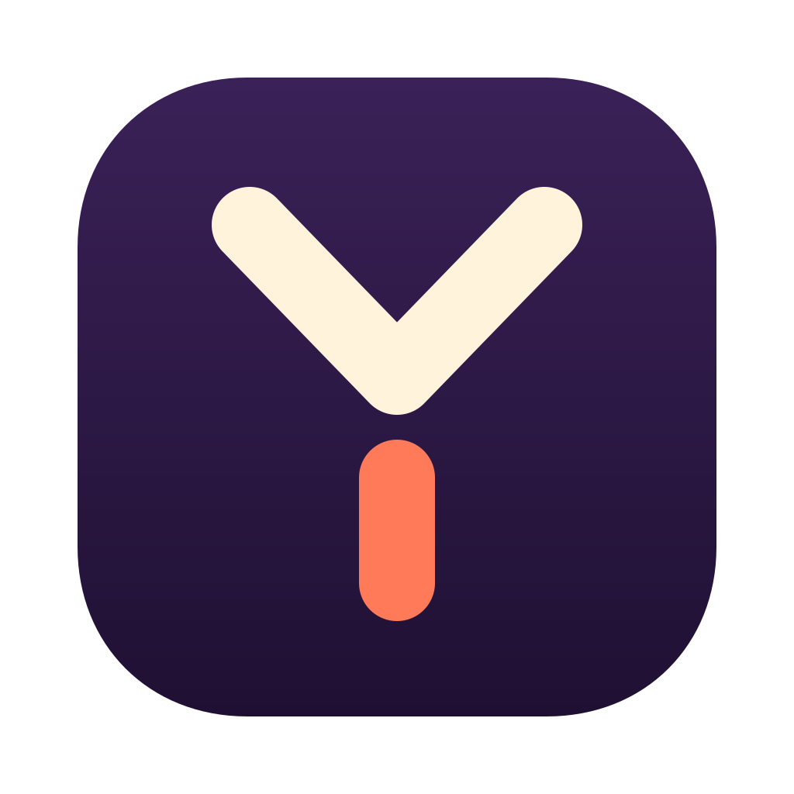
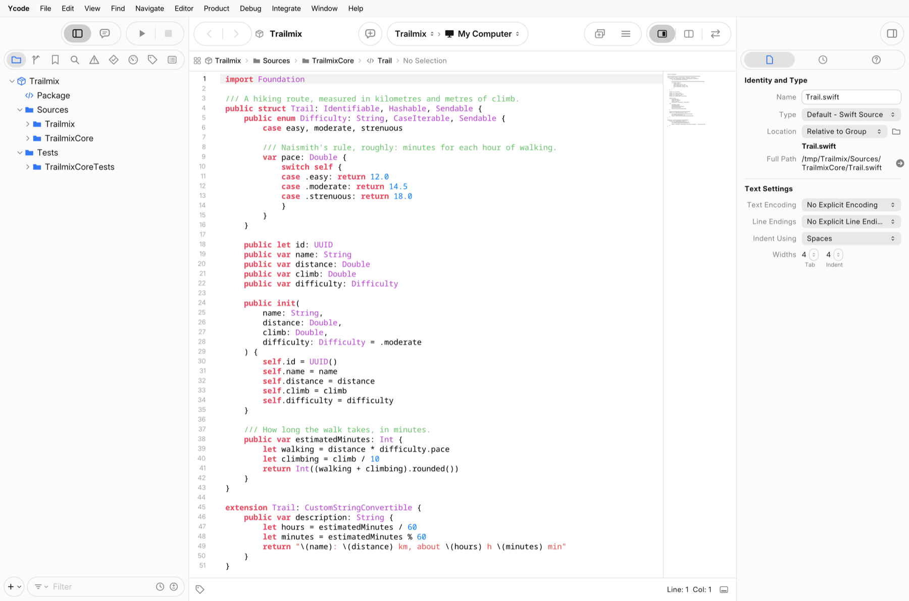

<p align="center">
  
</p>

<h1 align="center">Ycode</h1>

<p align="center">
  <strong>An independent, open-source IDE for Apple-platform projects, on macOS and Linux.</strong><br>
  It opens real projects, builds them, and writes files that stay compatible.
</p>

<p align="center">
  <a href="https://github.com/MarcoDotIO/Ycode/actions/workflows/ci.yml"></a>
  <a href="https://github.com/MarcoDotIO/Ycode/releases"></a>
  <a href="LICENSE"></a>
  
  <a href="https://flatpark.org/apps/io.github.MarcoDotIO.Ycode/"></a>
</p>

<p align="center">
  <a href="#install">Install</a> ·
  <a href="#what-works-today">What works</a> ·
  <a href="#build-from-source">Build from source</a> ·
  <a href="#simulators-experimental">Simulators</a> ·
  <a href="docs/README.md">Documentation</a> ·
  <a href="CONTRIBUTING.md">Contributing</a>
</p>

<picture>
  <source media="(prefers-color-scheme: dark)" srcset="docs/images/hero-dark.png">
  <source media="(prefers-color-scheme: light)" srcset="docs/images/hero-light.png">
  
</picture>

> [!NOTE]
> **This is a public beta (1.0.0-beta.2).** The project file formats and command-line tools are the most
> mature part. The IDE is usable and still has rough edges, and the Linux IDE is well behind the macOS one.
> Keep your projects under version control, and please [report what you find](https://github.com/MarcoDotIO/Ycode/issues/new/choose).

## What is Ycode?

Ycode is a desktop IDE for projects that target Apple platforms. It reads and writes the same files as
Apple's Xcode (`.xcodeproj`, `.xcworkspace`, `.xcscheme`, `.xcconfig`, Swift packages), so you can move a
project between the two tools and keep your colleagues' diffs small.

It is written from scratch in Swift under a [clean-room protocol](#clean-room): **it contains no Apple
code.** It builds with the compilers and SDKs you have installed, and it ships none of Apple's.

**Ycode may suit you if** you want to edit, build and run Swift projects on Linux, you need `xcodebuild`-style
tooling or project-file handling you can read and change, or you want to take part in an open IDE.

**It won't suit you yet if** you need a drop-in replacement for Xcode to ship an app. Signing and
distribution are partial, and physical devices are only listed.

## What works today

**Beta** means usable and tested. **Experimental** means it works in the cases we tried and you should
expect gaps. **Not yet** means it isn't there. The full audit against Xcode 27.1 is in
[docs/PARITY.md](docs/PARITY.md).

### Project files and command-line tools

| Feature | macOS | Linux |
|---|---|---|
| Read and write `.pbxproj`, `.xcworkspace`, `.xcscheme`. Round trips of Xcode-written files are byte-identical on our test corpus. | Beta | Beta |
| Resolve build settings (`.xcconfig`, defaults, conditions). [111,310 of 111,310 values](specs/xcodebuild/conformance.md) match `xcodebuild -showBuildSettings` across our corpus. | Beta | Beta |
| `ycodebuild`, an `xcodebuild`-compatible command line. [363 of 363 checks](specs/xcodebuild/conformance.md) match on our corpus. | Experimental | Experimental: settings and queries; building needs its build helper |
| `ycode assets` and `ycode strings`: asset catalog and String Catalog compilers | Experimental | Experimental |
| `ycode mcp`: an MCP server that lets coding agents build, test and search. Read-only unless you pass `--allow-writes`. | Experimental | Experimental |
| `ycode profile`: Gauge, a sampling profiler | Not yet for Mac processes | Experimental |

### The IDE

<!-- Linux rows below describe the main line. Update them as more Linux features land. -->

| Feature | macOS | Linux |
|---|---|---|
| Open projects, workspaces and Swift packages; Welcome window; New Project | Beta | Experimental |
| Project navigator, Find in workspace, Issues | Experimental | Experimental |
| Debug and Breakpoint navigators | Experimental | Experimental: new in this beta |
| Source Control, Test and Report navigators | Experimental | Experimental: new in this beta |
| Symbol navigator | Experimental | Experimental: new in this beta; declarations by file, a filter that also asks SourceKit-LSP |
| View source with syntax highlighting | Experimental | Experimental |
| Edit and save source files: undo, find and replace, jump to line, safe saves with crash recovery | Experimental | Experimental |
| Build | Experimental: swift-build, with an `xcodebuild` fallback | Experimental: Swift packages, through SwiftPM |
| Run | Experimental: My Mac and simulators | Experimental: Swift packages, with console output |
| Debugger (breakpoints, stepping, variables) through `lldb-dap` | Experimental | Experimental: Swift packages; gutter breakpoints, stepping, variables, the `(lldb)` console |
| Language features through SourceKit-LSP (completion, definition, rename, live issues) | Experimental | Experimental: live issues, completion, Quick Help, Jump to Definition, rename, references and callers |
| Plist, asset catalog and String Catalog editors; Interface Builder documents; SwiftUI previews | Experimental | Experimental: plist (XML, binary, OpenStep), asset catalog and String Catalog editors; Interface Builder documents (outline, canvas, Library objects, inspectors, constraints); SwiftUI previews in the canvas, rendered with OpenViews and updated as you type; UIKit previews on a paired simulator host |
| Source control (git): changes, commit, branches, tags, stashes, history, push and pull | Experimental | Experimental: new in this beta |
| Tests: run all, a suite or one test; results per test; failures at their lines | Experimental | Experimental: Swift packages (XCTest and Swift Testing) |
| Organizer | Experimental | Experimental: archives (list, details, Show in Files); no distribution yet |
| Coding assistant (local models, OpenAI, agent CLIs); you review each proposed change | Experimental | Experimental: new in this beta |
| Settings, themes and key bindings | Experimental | Experimental: General, Appearance (theme editing), Accounts, Behaviors, Navigation, Notifications, Editing, Shortcuts, Source Control, Locations |
| Signing and distribution | Experimental: partial | Not yet |
| Physical devices | Listed only | Not yet |

### Other parts of this repository

| Part | State |
|---|---|
| [Simulators](#simulators-experimental) for iOS, iPadOS, watchOS and visionOS, on arm64 Linux with KVM | Experimental |
| [Open frameworks](frameworks/README.md): Swift packages that also build on Linux. Contacts, EventKit, HealthKit, HomeKit, StoreKit, WeatherKit and SwiftUI (OpenViews, which draws the Linux IDE), plus a USD library | Experimental and partial; each README lists what is done |
| [Scene Composer](docs/SCENE-COMPOSER.md): `ycode-scene`, a command-line core for USD scenes | Experimental; no editor window yet |

## Install

Download from the [Releases page](https://github.com/MarcoDotIO/Ycode/releases). During the beta the version
numbers end in `-beta.N`, and each release has a `SHA256SUMS.txt`.

### macOS

**Requires** macOS 15 or later on Apple silicon. The Liquid Glass look needs macOS 26 or later. To build
anything you also need Xcode from Apple, which provides the compilers and SDKs. Ycode is developed against
Xcode 27.1.

1. Download `Ycode-1.0.0-beta.2.dmg` and open it.
2. Drag **Ycode** to **Applications**.
3. Open Ycode from Applications.

#### Opening an ad-hoc signed build

The release notes say whether a build is notarized. If it is ad-hoc signed, macOS blocks the first launch.
Try to open Ycode once, then go to **System Settings ▸ Privacy & Security** and choose **Open Anyway**.

### Linux (Flatpak)

**Requires** x86-64 or arm64 (aarch64), Flatpak, and [Swift 6.4 installed on the host](https://www.swift.org/install/linux/).
Ycode uses your host's Swift toolchain to build.

The easiest way is [FlatPark](https://flatpark.org/apps/io.github.MarcoDotIO.Ycode/). It installs the Linux release
from this repository's Releases page, checks it against a pinned checksum, and brings new releases with `flatpak update`:

```sh
flatpak remote-add --user --if-not-exists flatpark https://dl.flatpark.org/flatpark.flatpakrepo
flatpak install --user flatpark io.github.MarcoDotIO.Ycode
flatpak run io.github.MarcoDotIO.Ycode
```

If you installed the bundle from an earlier release, remove it first with
`flatpak uninstall --user io.github.MarcoDotIO.Ycode`. Your settings are kept.

Or install the bundle from the Releases page:

```sh
flatpak remote-add --user --if-not-exists flathub https://dl.flathub.org/repo/flathub.flatpakrepo
flatpak install --user ./Ycode-1.0.0-beta.2-x86_64.flatpak      # or -aarch64
flatpak run io.github.MarcoDotIO.Ycode
```

> [!IMPORTANT]
> **This Flatpak isn't really sandboxed.** To reach your Swift toolchain it runs commands on the host
> through `flatpak-spawn --host`, which is what the `org.freedesktop.Flatpak` permission allows. Treat it
> like any other program you run on your machine. [packaging/README.md](packaging/README.md) lists every
> permission and why it's there.

### First steps

1. In the Welcome window, choose **Open…** and pick a project, a workspace or a folder with a
   `Package.swift`.
2. Choose a scheme and a destination in the toolbar.
3. Build with <kbd>⌘B</kbd> and run with <kbd>⌘R</kbd>. On Linux the Command key is <kbd>Ctrl</kbd>.

## Build from source

You need Swift 6.4: Xcode 27 on macOS, or the [swift.org release](https://www.swift.org/install/) on Linux.
On Ubuntu, also install `libsqlite3-dev`. Clone the whole repository, because `ycode/` uses
`frameworks/swiftui` by path.

```sh
git clone https://github.com/MarcoDotIO/Ycode.git
cd Ycode/ycode
swift build
swift test
```

**On macOS**, build the app, which appears at `.build-ide/app/Ycode.app`:

```sh
scripts/make-app.sh
```

**On Linux**, run the IDE directly. It loads SDL3 at run time: install it from your distribution if it has
SDL3, or point `OV_SDL3_LIBRARY` at your own `libSDL3.so.0`.

```sh
.build/debug/ycode-ide path/to/Package.swift
```

**The command-line tools** work on both systems:

```sh
.build/debug/ycode describe path/to/App.xcodeproj
.build/debug/ycode roundtrip path/to/App.xcodeproj
.build/debug/ycodebuild -list -project path/to/App.xcodeproj
```

[ycode/README.md](ycode/README.md) has the rest: every tool, the tests and the opt-in test inputs.

## Simulators (experimental)

Ycode's simulator runs Apple's simulator runtimes on **arm64 Linux**, with its own Darwin kernel layer in
KVM micro-VMs and Metal translated to Vulkan. It is the most experimental part of the project: slower than
Apple's simulator on a Mac, and incomplete.

**Nothing of Apple's ships here.** No runtime, SDK, firmware, artwork or font is in this repository or in
the packages, and Ycode doesn't download or decrypt any of it. You supply a simulator runtime from your own
Xcode installation, and you are responsible for following Apple's licence terms for it. Check whether those
terms allow your setup before you use it.

**What you need**

- An arm64 Linux host with `/dev/kvm` and a Vulkan driver (developed on an NVIDIA Jetson, Ubuntu 24.04).
- Your own copy of a simulator runtime, and room for devices on a data volume.
- To watch from elsewhere, a viewer: macOS or x86-64 Linux can show the device over the network. x86-64
  Linux can't run the simulator itself.

| Platform | Boots | Input | Notes |
|---|---|---|---|
| iOS 27.0, 27.1 | Yes | Touch, keyboard, buttons | Cold boot about 1.4× the time on a Mac; apps install and launch |
| iPadOS | Yes | Partial | Touch works; apps install and launch |
| watchOS 27.0 | Yes | Partial | Pairing with an iPhone works |
| visionOS 27.0 | Partly | Partial | Open problems remain in the room and the home view |
| tvOS | No | | |

The figures and open problems are in [docs/SIMULATOR.md](docs/SIMULATOR.md), and the setup is in
[docs/SIMULATOR-LINUX.md](docs/SIMULATOR-LINUX.md).

## Clean room

Ycode is developed under a two-room protocol, so that it stays independent and can be released:

- **Dirty room (`research/`).** Xcode is studied only to learn *what* it does: file formats, protocols and
  observable behaviour. Decompiler and disassembler output never leaves an untracked local folder.
- **The boundary (`specs/`).** Only written specifications cross over. They describe behaviour and formats,
  never Apple's code, and each one lists its evidence.
- **Clean room (`ycode/`, `frameworks/`, `composer/`).** Code is written only from the specs, public
  documentation and suitably licensed open source.

Every contribution follows these rules. [CONTRIBUTING.md](CONTRIBUTING.md) explains what they mean in
practice, and [AGENTS.md](AGENTS.md) is the full protocol.

## Architecture at a glance

```text
 macOS: Ycode.app (AppKit)            Linux: ycode-ide (SwiftUI on OpenViews, SDL3, Vulkan)
          │                                     │
          └──────────────┬──────────────────────┘
                 YcodeIDECore: the portable IDE model
                         │
   Project files          Build                Language and debug
   YcodePlist             YcodeBuild           YcodeLanguage → sourcekit-lsp
   YcodeProject           YcodeXcodebuild      YcodeDebug    → lldb-dap
   YcodeWorkspace         → swift-build
   YcodeSettings          → SwiftPM

 Simulator (arm64 Linux): ycode-simd → Darwin kernel layer → KVM; Metal → Vulkan
```

Ycode reuses open-source tools where they exist and rebuilds what isn't open. Read
[docs/ARCHITECTURE.md](docs/ARCHITECTURE.md) for the modules, and
[docs/README.md](docs/README.md) for a guide to the documentation and the top-level folders.

## Roadmap

This is the direction of the project, not a set of promises or dates. Items can move between releases.
The full gap list is in [docs/PARITY.md](docs/PARITY.md) and the longer view in [docs/FUTURE.md](docs/FUTURE.md).

### 1.0 betas: finishing what is here

- **Linux IDE:** what the macOS IDE has and the Linux one still lacks: a Device Hub, recording in the device
  window, and UIKit previews at interactive speed. Language features, the navigators, the debugger, Source Control
  and the coding assistant arrived in 1.0.0-beta.2; Settings ▸ Accounts, the conflict editor, the Organizer,
  SwiftUI previews, Interface Builder documents and debugging on a simulator arrive in 1.0.0-beta.3.
- **Fixes from beta reports.** Please [file them](https://github.com/MarcoDotIO/Ycode/issues/new/choose).
- **Distribution:** listed on [FlatPark](https://flatpark.org/apps/io.github.MarcoDotIO.Ycode/) since 1.0.0-beta.1, alongside the GitHub release.

### Version 2: Xcode 27.2 parity

| Area | What's planned | State |
|---|---|---|
| Project files | The JSON `.xcproj` project format that Xcode 27.2 adds as an opt-in, read and written alongside `.pbxproj` | Planned |
| Platforms | Opening, building and templating projects for the HomeView platform in Xcode 27.2 | Investigating |
| App Intents | App skills for Siri (`.skillsbundle`): the template, validation of each `SKILL.md`, and the built output | Planned; the API is a developer preview |
| Device Hub | Shake, memory pressure, slow animations and Standby | Planned |
| Editor | Rendered Markdown with formatting tools; `#Playground` | Planned |
| Icons | Icon Composer 2.0 documents, and an `.icon` viewer | Partial: `.icon` files build into app icons today |
| Command line | `simctl`-style verbs for Ycode's simulators, including reboot | Partial |
| Coding assistant | Edit history, and the newer agent and plug-in workflows | Partial: chat, proposals, `ycode mcp` |

### Further out

- **Signing, distribution and physical devices,** so an app can go from Ycode to a device and a store.
- **Simulators:** speed and fidelity first, then tvOS, visionOS input, and wearing the visionOS simulator in a
  headset (an OpenXR viewer exists and is experimental).
- **AR on the simulator:** a virtual iPhone inside a room, giving ARKit and RealityKit apps camera, depth and
  pose data.
- **Interface Builder** connections and Auto Layout, and the Core Data model editor.
- **Profiling** of Mac processes, with allocations and leaks.
- **Scene Composer:** an editor window for USD scenes on top of today's command-line core.
- **More open frameworks** for code that targets Apple's APIs on Linux.

Changes are recorded in [CHANGELOG.md](CHANGELOG.md).

## FAQ

**Is this a fork of Xcode?**
No. Xcode isn't open source, and no Apple code is in Ycode. Ycode matches its file formats and observable
behaviour, and reuses Apple's *open-source* projects such as swift-build, SwiftPM and SourceKit-LSP under
their licences.

**Will Ycode change my project files?**
It writes the same formats as Xcode. Round trips are byte-identical on our test corpus, but that corpus isn't
every project, so keep your work under version control and report any unexpected diff.

**Can I edit code on Linux?**
Yes, as of this beta: the Linux editor has undo, find and replace, and saves that can't leave a half-written
file. Build errors and SourceKit-LSP's live issues show in the editor, and Ctrl+Space lists completions.

**Can I build iOS apps on Linux?**
That needs Apple's iOS SDK, which Ycode doesn't ship and which Apple licenses for use on Apple-branded
hardware. The usual setup builds on a Mac. Swift packages for Linux build with no Apple software at all.

**Can I submit an app to the App Store with it?**
Not yet. Use Xcode for that.

**Does Ycode collect data?**
It has no telemetry. It uses the network for things you ask for: resolving packages, cloning, a coding
assistant you set up, and connecting to a simulator host.

**Does it run on Windows or Intel Macs?**
Not at this time. The packages are built for Apple silicon Macs and for x86-64 and arm64 Linux.

**Where do I get help?**
See [SUPPORT.md](SUPPORT.md). To report a security problem, follow [SECURITY.md](SECURITY.md).

## Licence

Ycode is released under the [MIT Licence](LICENSE). Third-party components keep their own licences, listed in
[THIRD_PARTY_NOTICES.md](THIRD_PARTY_NOTICES.md). By contributing, you agree that your contributions are
licensed under the MIT Licence.

---

Ycode is not affiliated with or endorsed by Apple Inc. Xcode, iOS, visionOS and others are trademarks of
Apple Inc.
